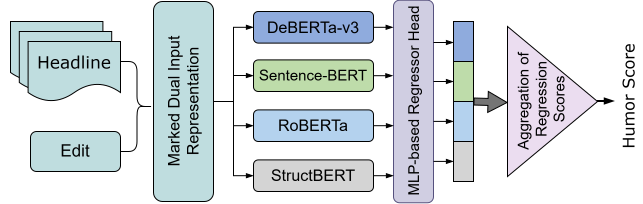

<div id="top"></div>

<br />

<div align="center">

  <h1 align="center">Getting the Joke: Stacking Diverse Transformers for Humor Intensity Regression in Edited News Headlines</h1>
  <p align="center">
    Joint work between the University of Chittagong, Shahjalal University of Science and Technology, and Chittagong University of Engineering and Technology
  </p>

  [Jannatul Naima](mailto:jannatulnaima.cse.cu@gmail.com), Trina Chakraborty, Swapnil Chowdhury, Mst Tuly Khatun, Monalisa Tripura, and Farjana Alam Tofa.
</div>

<!-- TABLE OF CONTENTS -->

<details open>
  <summary>Table of Contents</summary>
  <ol>
    <li>
      <a href="#about-the-project">About The Project</a>
    </li>
    <li>
      <a href="#getting-started">Getting Started</a>
      <ul>
        <li><a href="#prerequisites">Prerequisites</a></li>
        <li><a href="#installation">Installation</a></li>
      </ul>
    </li>
    <li><a href="#reproduce-results">Reproduce results</a></li>
    <li><a href="#license">License</a></li>
    <li><a href="#contact">Contact</a></li>
    <li><a href="#references">References</a></li>
  </ol>
</details>


<!-- ABOUT THE PROJECT -->

## About The Project

This repository contains the code and predictions for our system for SemEval-2020 Task 7 (Subtask 1), which predicts how funny a news headline is after a single word has been replaced, as a score from 0 to 3 on the Humicroedit dataset. We fine-tune several transformer encoders (DeBERTa-v3, RoBERTa, StructBERT, Sentence-BERT) and combine their predictions with a stacking ensemble. The final system reaches a test RMSE of 0.4858.
<p align="center">
  
</p>
:star2: Official implementation to reproduce the main results of our paper "Getting the Joke: Stacking Diverse Transformers for Humor Intensity Regression in Edited News Headlines".

**If you use our code, please consider citing:**

    @unpublished{naima2026gettingthejoke,
      title={Getting the Joke: Stacking Diverse Transformers for Humor Intensity Regression in Edited News Headlines},
      author={Naima, Jannatul and Chakraborty, Trina and Chowdhury, Swapnil and Khatun, Mst Tuly and Tripura, Monalisa and       Tofa, Farjana Alam},
      note={International Conference on Machine Intelligence and
      Emerging Technologies (MIET 2026, Bangladesh)},
      year={2026}
    }

<!-- GETTING STARTED -->

## Getting Started

### Prerequisites

* Python 3.10 or higher
* pip version 21 or higher

### Installation

1. Clone the repo

   ```sh
   git clone https://github.com/jannatulnaima-duck/humicroedit-stacking.git && cd humicroedit-stacking
   ```

2. Create and activate an environment

   ```sh
   python -m venv .venv
   source .venv/bin/activate
   ```

3. Install required libraries

   ```sh
   pip install -r requirements.txt
   ```

<!-- USAGE EXAMPLES -->

## Reproduce results

### 1. Fine-tune the base models

```
cd notebooks/
jupyter notebook 01_base_model_training.ipynb
```

This fine-tunes the eight transformer models and saves their dev and test predictions under `predictions/`. A GPU is needed. The predictions we used are already included, so you can skip this step.

### 2. Stacking ensemble

```
jupyter notebook 02_stacking_ensemble.ipynb
```

* This reads the files in `predictions/` and runs on CPU.
* `STACK_MODELS` in the notebook chooses which base models are combined.
* The results are stored under the folder `results/`.

<!-- LICENSE -->

## License

Distributed under the MIT License.


<!-- CONTACT -->

## Contact

The code was done and maintained by Jannatul Naima - jannatulnaima.cse.cu@gmail.com.
Contact us via email or create github issues if you have any questions/requests. Thanks!


<!-- ACKNOWLEDGMENTS -->

## References

* Nabil Hossain, John Krumm, Michael Gamon, and Henry Kautz. 2020. SemEval-2020 Task 7: Assessing Humor in Edited News Headlines. In Proceedings of the Fourteenth Workshop on Semantic Evaluation.
* Pengcheng He, Jianfeng Gao, and Weizhu Chen. 2023. DeBERTaV3: Improving DeBERTa using ELECTRA-Style Pre-Training with Gradient-Disentangled Embedding Sharing. In ICLR 2023.
* Nils Reimers and Iryna Gurevych. 2019. Sentence-BERT: Sentence Embeddings using Siamese BERT-Networks. In Proceedings of EMNLP-IJCNLP 2019.
* Huggingface. 2022. [Transformers](https://github.com/huggingface/transformers).

<p align="right">&#40;<a href="#top">back to top</a>&#41;</p>

<!-- MARKDOWN LINKS & IMAGES -->

[framework]: images/framework.png
